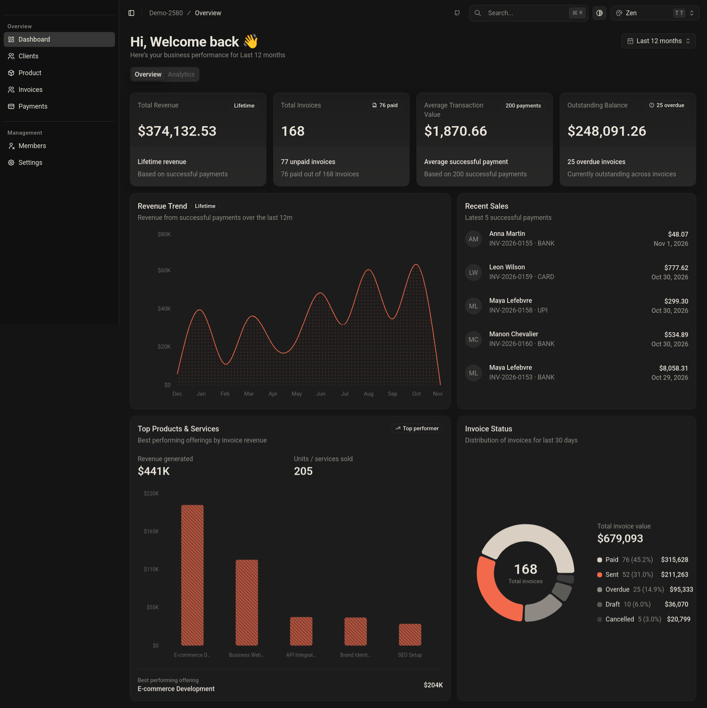
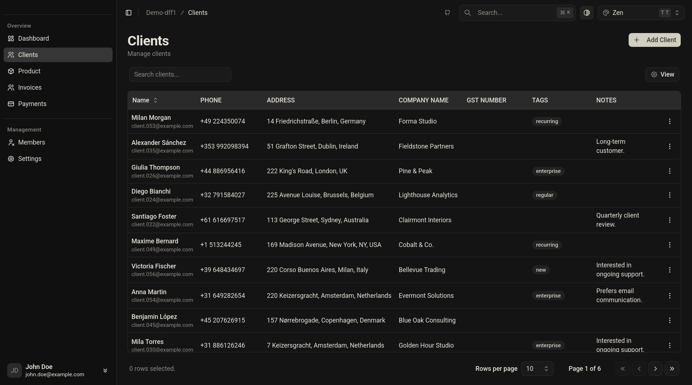
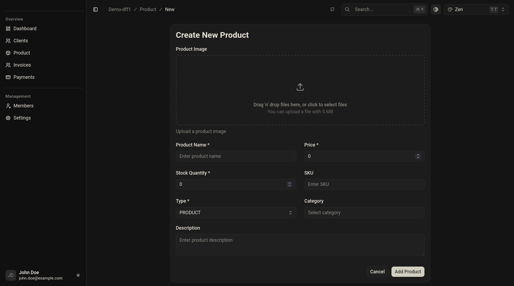
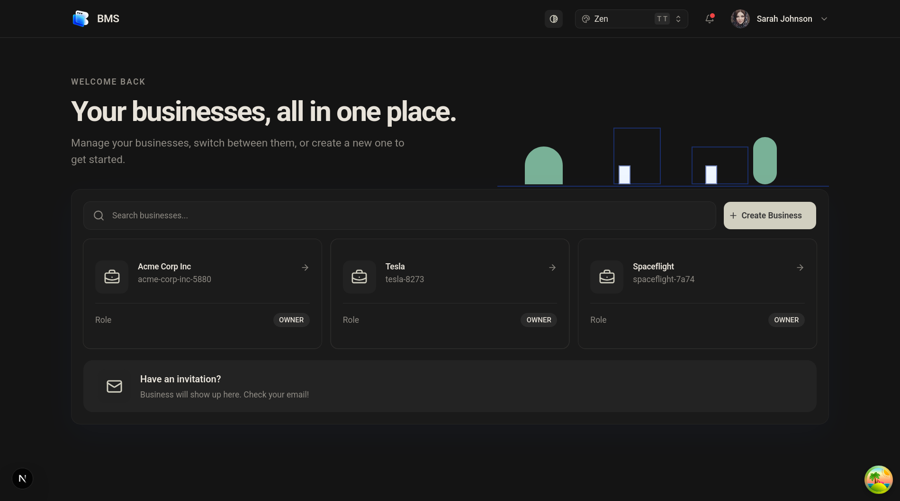
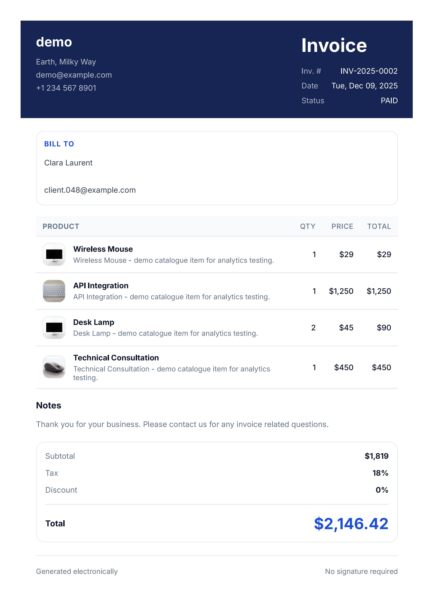

# Business Management System — Frontend

> 🧪 **Testing Phase:** The core features of this project have been implemented. The application is currently undergoing testing, bug fixing, and refinement. Some functionality may still change as issues are identified and resolved.

The frontend for the **Business Management System (BMS)**, a web application designed to simplify business operations such as client management, product and service management, invoicing, and payments.

Built with **Next.js and TypeScript**, BMS provides a responsive dashboard for managing business operations, tracking financial performance, and interacting with the BMS backend.

**Backend Repository:** [Business Management System — Backend](https://github.com/NHeroOP/Business-Management-System-Backend)

## Screenshots

### Dashboard (Image extended to show the full page)


### Clients


### Product Create Form


### Home


### Invoice PDF


## Features

### Business Management
- Create and manage businesses.
- Business-specific dashboards and navigation.
- Switch between businesses.
- Business-scoped data and operations.

### Dashboard & Analytics
- Business overview with key performance indicators.
- Revenue tracking and period-based comparisons.
- Revenue trend visualization.
- Invoice statistics and payment summaries.
- Outstanding balance and overdue invoice tracking.
- Top clients and products.
- Recent sales activity.
- Analytics filtering by date range.

### Core Business Operations
- Client management.
- Product and service management.
- Invoice creation and management.
- Invoice item and quantity management.
- Payment tracking.
- Search and pagination.

### Account & Profile
- Profile management.
- Profile information updates.
- Profile avatar management.
- Account security and verification information.

### General
- Responsive dashboard layout.
- Reusable UI and form components.
- Form validation.
- Notifications and feedback.
- Backend API integration.
- Business-specific data handling.

## Tech Stack

| Category | Technology |
|---|---|
| Framework | [Next.js 16](https://nextjs.org/) |
| Language | [TypeScript](https://www.typescriptlang.org/) |
| UI Library | [React](https://react.dev/) |
| Components | [shadcn/ui](https://ui.shadcn.com/) |
| Styling | [Tailwind CSS v4](https://tailwindcss.com/) |
| Data Fetching & Caching | [TanStack Query](https://tanstack.com/query) |
| Forms | [TanStack Form](https://tanstack.com/form) |
| Validation | [Zod](https://zod.dev/) |
| Notifications | [Sonner](https://sonner.emilkowal.ski/) |
| URL State Management | [nuqs](https://nuqs.47ng.com/) |
| Package Manager | [bun](https://bun.sh/) |

## Getting Started

### Prerequisites

Make sure you have the following installed:

- [Node.js](https://nodejs.org/)
- [bun](https://bun.sh/)
- A running instance of the [BMS backend](https://github.com/NHeroOP/Business-Management-System-Backend)

### Installation

Clone the repository:

```bash
git clone https://github.com/HeyNeerav/Bms-Frontend.git

cd Bms-Frontend
```

Install dependencies:

```bash
bun install
```

### Environment Setup

Create a `.env` file in the project root:

```env
BACKEND_API_URL=your_backend_api_url
```

Replace `your_backend_api_url` with the URL of your running BMS backend.

### Development

Start the development server:

```bash
bun run dev
```

Open [http://localhost:3000](http://localhost:3000) in your browser.

## Backend

The frontend communicates with the BMS backend for authentication and business operations, including business management, clients, products, services, invoices, and payments.

**[View the Backend Repository](https://github.com/NHeroOP/Business-Management-System-Backend)**

## Acknowledgements

The dashboard UI is based on [Next Shadcn Dashboard Starter](https://github.com/Kiranism/next-shadcn-dashboard-starter) by [Kiranism](https://github.com/Kiranism).

The starter provided the initial dashboard foundation, which has been adapted and extended to support the Business Management System's features and workflows.

## License

This project uses the MIT License. The original dashboard template is Copyright (c) 2023 Kiranism.

See the [LICENSE](./LICENSE) file for the full license and copyright notice.