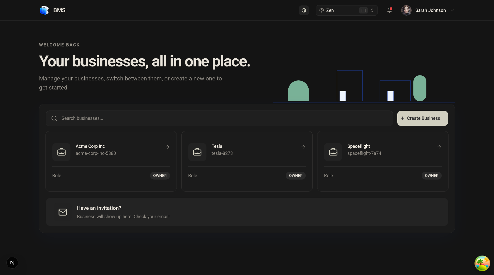
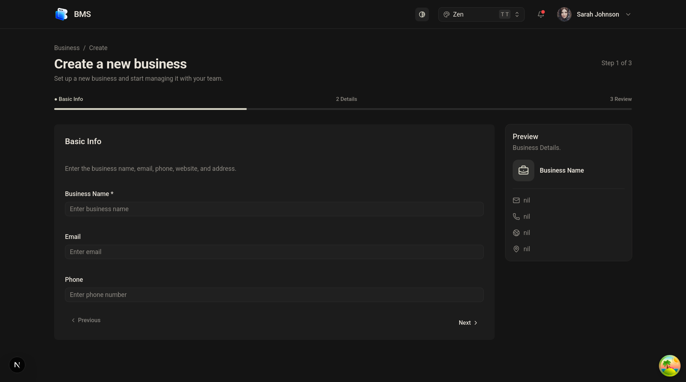
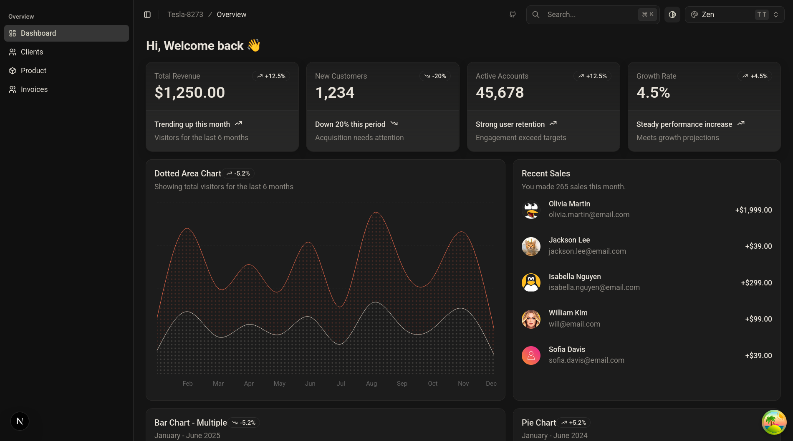
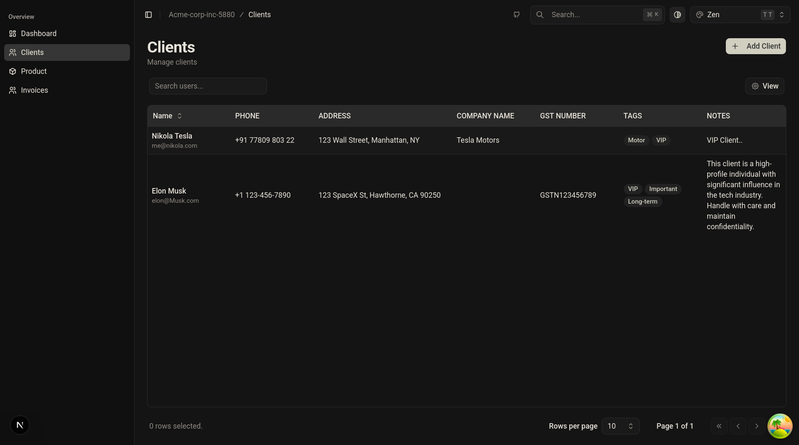
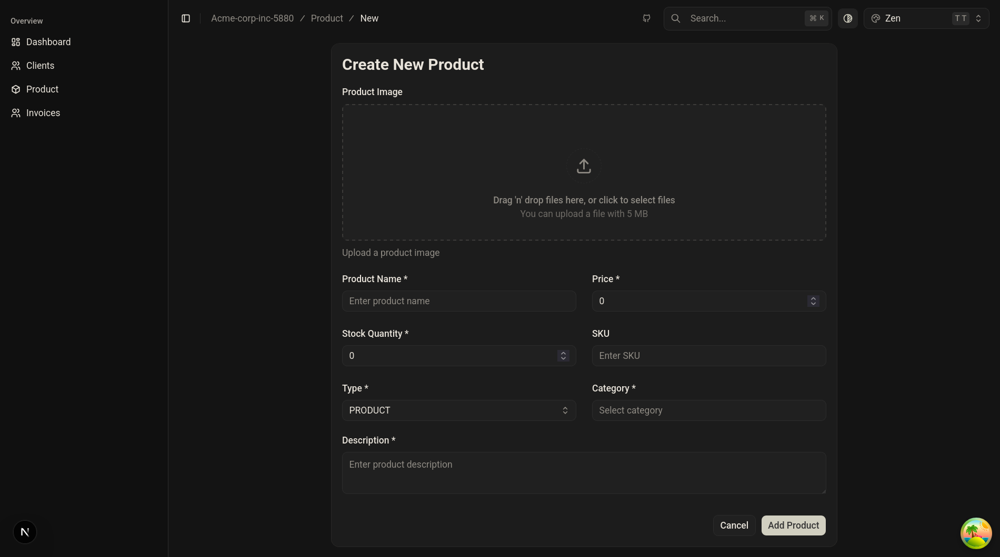

# Business Management System — Frontend

> 🚧 This project is a work in progress. Some features may be incomplete or change as development continues.

The frontend for the Business Management System (BMS), a web application for managing business operations such as clients, products, invoices, and payments.

Built with Next.js and TypeScript, the application provides a dashboard for managing business data and communicating with the BMS backend.

**Backend repository:** [Business Management System — Backend](https://github.com/NHeroOP/Business-Management-System-Backend)

## Screenshots

### Home



### Create Business



### Dashboard



### Clients



### Product Create Form



## Features

- Business dashboard
- Client management
- Product and service management
- Invoice creation and management
- Invoice item and quantity management
- Search and pagination
- Form validation
- Business-specific data and navigation
- Reusable form components
- Responsive dashboard layout
- API integration with the backend

## Tech Stack

- **Framework:** Next.js 16
- **Language:** TypeScript
- **UI:** React and shadcn/ui
- **Styling:** Tailwind CSS v4
- **Data Fetching:** TanStack Query
- **Forms:** TanStack Form
- **Validation:** Zod
- **Notifications:** Sonner
- **Package Manager:** bun

## Getting Started

### Requirements

- Node.js
- bun
- A running BMS backend

### Installation

Clone the repository:

```bash
git clone https://github.com/HeyNeerav/Bms-Frontend.git
cd Bms-Frontend
```

Install the dependencies:

```bash
bun install
```

### Environment Setup
Create a `.env` file in the root directory and add the following environment variables:

```bash
BACKEND_API_URL=your_backend_api_url
```

### Development

Start the development server:

```bash
bun run dev
```

Open [http://localhost:3000](http://localhost:3000) in your browser.

## Backend

The frontend communicates with the BMS backend for authentication, business data, clients, products, invoices, and other operations.

**[View the backend repository](https://github.com/NHeroOP/Business-Management-System-Backend)**

## License

This project is available under the license specified in the repository's `LICENSE` file.
